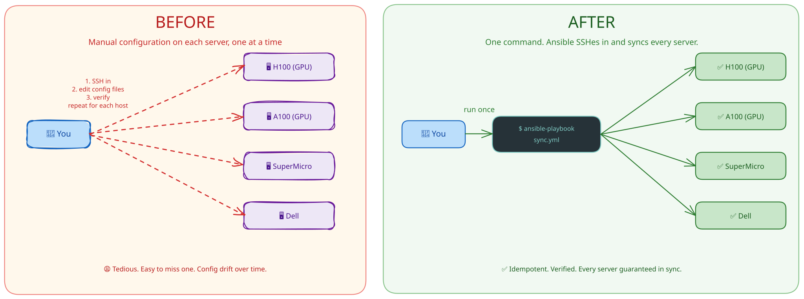

# Dev Environment Sync

Ansible playbooks to keep your development environment — shell config, VSCode settings, Git config, Docker, SSH, and more — in sync across the lab's GPU servers and your local machine.

## The Problem This Solves

When you SSH into four different servers (H100, A100, SuperMicro, Dell), each one can feel like a slightly different machine: your `.bashrc` aliases aren't there, Git uses the wrong email, your VSCode extensions aren't configured, Docker isn't set up the way you need it. Manually copying config files across servers is tedious and error-prone.

This repo automates that. You edit a config file once, run one command, and every server stays in sync.



## What Is Ansible?

Ansible is a tool that connects to remote machines over SSH and runs a set of instructions you define in YAML files called **playbooks**. You don't need to install anything on the remote servers — Ansible only needs to be installed on your local machine. It reads an **inventory** file to know which servers to target, then applies each playbook's tasks in order.

Think of it like a "git push, but for your config files and system settings."

## Servers This Manages

| Alias | Hardware     | Role          |
|-------|--------------|---------------|
| `h100`  | H100 GPU node  | Remote server |
| `a100`  | A100 GPU node  | Remote server |
| `sm`    | SuperMicro node | Remote server |
| `dell`  | Dell node       | Remote server |
| `localhost` | Your Mac   | Local machine |

All remote servers are accessed via a jump host (`uth_jump`). Your `~/.ssh/config` handles the connection details; Ansible just piggybacks on it.

## What Gets Synced

| Playbook | What it does | Target |
|----------|-------------|--------|
| `bash`   | Deploys `.bashrc`, aliases, and shell scripts | Remote servers |
| `zsh`    | Deploys `.zshrc` and Zsh config | Local machine |
| `ssh`    | Deploys `~/.ssh/config` | Local machine |
| `git`    | Deploys `.gitconfig` | Local machine |
| `vscode` | Deploys VSCode `settings.json` | Local machine |
| `docker` | Sets up rootless Docker with NVIDIA GPU support | Remote servers |
| `uv`     | Installs `uv` and Python tools (`yamllint`, `yamlfix`) | Remote servers |
| `go`     | Installs Go to `~/.local/go` | Remote servers |
| `nodejs` | Installs NVM and Node.js | Remote servers |
| `claude` | Deploys global `~/.claude/CLAUDE.md` | Remote servers |

## Prerequisites

- Python 3 installed on your local machine
- SSH access to the lab servers 
- Your SSH key added to each server's `~/.ssh/authorized_keys`

## Setup

### 1. Install Ansible

**macOS / Linux**

```bash
python3 -m pip install --user pipx
pipx install --include-deps ansible
```

**Windows (WSL2)**

Ansible doesn't run natively on Windows, but works fine inside WSL2.

1. Install WSL2 with Ubuntu (run in PowerShell as Administrator):

   ```powershell
   wsl --install
   ```

   Restart when prompted, then open the Ubuntu app to finish setup.

2. Inside the WSL2 terminal, install Ansible:

   ```bash
   sudo apt update && sudo apt install -y pipx
   pipx install --include-deps ansible
   pipx ensurepath
   ```

   Then restart your WSL2 terminal (or `source ~/.bashrc`) so `ansible` is on your PATH.

3. All subsequent commands in this README should be run from inside the WSL2 terminal.

### 2. Clone this repo

```bash
git clone <repo-url>
cd uth-ansible-playbooks
```

### 3. Configure the vault password

Sensitive values (server IPs, tokens, etc.) are encrypted with [Ansible Vault](https://docs.ansible.com/ansible/latest/vault_guide/index.html) (AES-256). You need a password file to decrypt them at runtime.

Ask the repo owner for the vault password, then write it to `.vault_pass`:

```bash
echo "the-password-you-were-given" > .vault_pass
chmod 600 .vault_pass
```

`.vault_pass` is gitignored. Never commit it. The `ansible.cfg` in this repo is already configured to pick it up automatically, so you won't need to pass `--vault-password-file` manually.

### 4. Verify connectivity

```bash
ansible all -m ping
```

You should see a `pong` response from each host. If a server is unreachable, check your SSH config and VPN connection.

## Usage

### Dry run first (always)

Before applying anything, preview what would change without touching any files:

```bash
ansible-playbook playbooks/<tool>/sync.yml --check --diff
```

`--check` simulates the run. `--diff` shows you exactly which lines in each file would be added or removed, like a git diff.

### Run all playbooks

```bash
./run-all-playbooks.sh
```

### Run a single playbook

```bash
ansible-playbook playbooks/bash/sync.yml
ansible-playbook playbooks/vscode/sync.yml
```

### Target a specific server

```bash
# One server by alias
ansible-playbook playbooks/bash/sync.yml -l h100

# A group of servers
ansible-playbook playbooks/bash/sync.yml -l uth

# Multiple servers
ansible-playbook playbooks/bash/sync.yml -l h100,a100
```

### Pass extra flags to all playbooks at once

```bash
./run-all-playbooks.sh --limit h100
./run-all-playbooks.sh --check --diff
```

## Project Layout

```
.
├── inventory.ini          # Which servers exist and how to reach them
├── ansible.cfg            # Ansible defaults (vault path, SSH args, etc.)
├── run-all-playbooks.sh   # Runs every playbook in order
├── group_vars/
│   ├── all/
│   │   ├── vars.yml       # Variables shared across all hosts
│   │   └── vault.yml      # Encrypted secrets shared across all hosts
│   └── uth/
│       ├── vars.yml       # Variables for the remote [uth] server group
│       └── vault.yml      # Encrypted secrets for [uth] servers
├── playbooks/
│   └── <tool>/
│       ├── sync.yml       # Entry point — run this to apply the config
│       ├── vars.yml       # Variables for this tool (packages, versions, etc.)
│       └── templates/     # Jinja2 templates for generated config files
└── tasks/
    └── backup_file.yml    # Shared task: back up a file before overwriting it
```

## Secrets and Ansible Vault

Sensitive values (IPs, tokens, passwords) live in `group_vars/**/vault.yml` files, encrypted with AES-256. Ansible decrypts them automatically at runtime using `.vault_pass`.

### Edit an existing vault file

```bash
ansible-vault edit group_vars/uth/vault.yml
```

### View a vault file without editing

```bash
ansible-vault view group_vars/all/vault.yml
```

### Encrypt a new file

```bash
ansible-vault encrypt group_vars/all/vault.yml
```

### Add a new secret

1. Open the vault file: `ansible-vault edit group_vars/uth/vault.yml`
2. Add your variable: `vault_my_secret: "value"`
3. Reference it in `vars.yml`: `my_secret: "{{ vault_my_secret }}"`
4. Use it in your playbook: `"{{ my_secret }}"`

The `vault_` prefix on raw secret variables is a convention that makes it easy to tell encrypted values from plain ones.

## Adding a New Tool

1. Create a directory: `playbooks/<tool>/`
2. Add `sync.yml` — the entry point playbook
3. Add `vars.yml` — any variables (packages, versions, file paths)
4. Add `templates/` — Jinja2 templates for any config files the playbook generates
5. Set `hosts: "{{ target_hosts | default('<group>') }}"` at the top of `sync.yml`
6. Test with `--check --diff` before running for real

## Common Issues

**"Host key verification failed"**
Ansible is configured with `host_key_checking = False` in `ansible.cfg`, so this shouldn't happen. If it does, check that your `~/.ssh/known_hosts` isn't manually blocking the host.

**"Permission denied (publickey)"**
Your SSH key isn't on the remote server. Either add it via `ssh-copy-id` or ask the sysadmin to add it to `~/.ssh/authorized_keys`.

**A playbook changed something you didn't expect**
The playbooks use `backup: yes` on file modifications, so the original file is saved alongside the new one with a timestamp suffix. Find it with `ls -la ~/<config-file>*` on the affected server.

**"Variable is undefined"**
A variable referenced in a playbook is missing from `vars.yml` or `group_vars/`. Check the playbook's `vars.yml` and the relevant `group_vars/<group>/vars.yml`.
